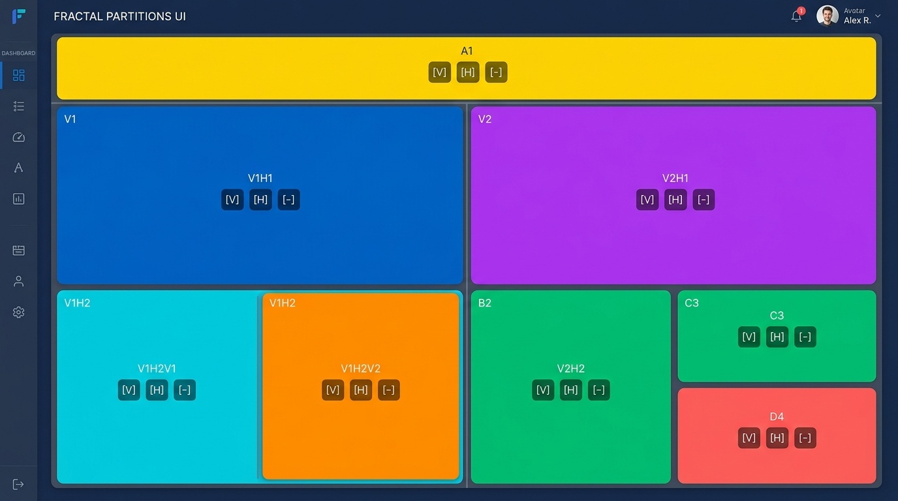
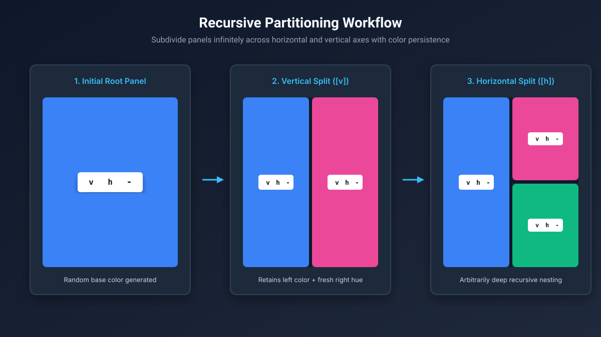
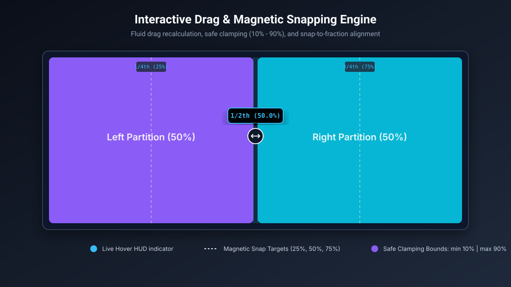
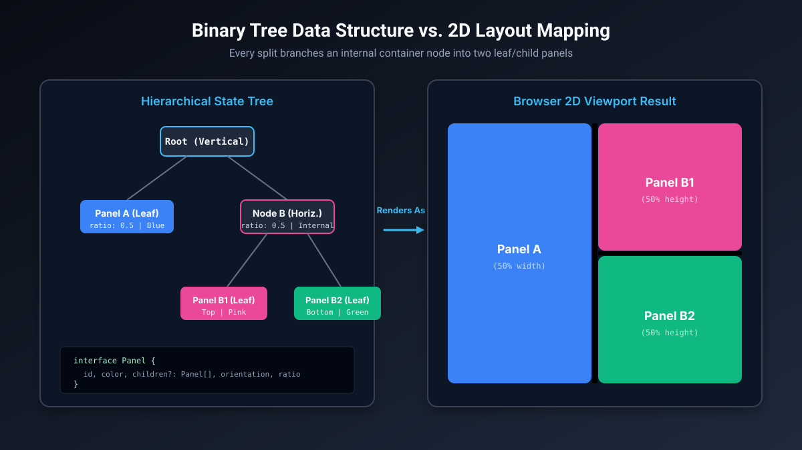
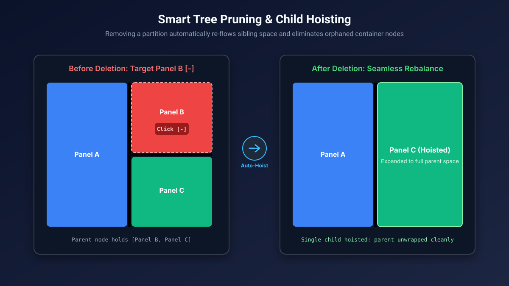

# Recursive Partitioner 🧩

<p align="center">
  <strong>An interactive, recursive split-pane layout engine built with React, TypeScript, and Zustand.</strong>
</p>

<p align="center">
  <a href="https://recursive-partitioner-beta.vercel.app" target="_blank">
    
  </a>
  <a href="https://github.com/Ramjanict/Recursive-Partitioner/stargazers">
    
  </a>
  
  
  
  
  
  
<p align="center">
  
</p>

---

## 🌐 Live Demo

Explore the live interactive playground: **[recursive-partitioner-beta.vercel.app](https://recursive-partitioner-beta.vercel.app)**

---

## 📖 Overview

**Recursive Partitioner** is a lightweight, zero-external-UI-dependency layout manager that enables arbitrary, recursive splitting and resizing of browser viewports. Inspired by tiling window managers (e.g., i3, tmux, bspwm) and modern multi-pane IDEs, it models the screen as an expandable binary tree data structure.

Every panel can be infinitely subdivided along horizontal or vertical axes, dynamically resized with smooth drag gestures, magnetically snapped to standard fractions, and seamlessly pruned with automatic tree rebalancing.

---

## ✨ Key Features

- **🌲 Recursive Tree Layout Architecture**:
  - Treats each partition as a node in an n-ary/binary layout tree.
  - Infinite depth splitting—divide any child panel as deeply as your screen permits.
- **🔀 Dual-Axis Partitioning**:
  - **Vertical Split (`v`)**: Slices a panel into left and right sub-panels.
  - **Horizontal Split (`h`)**: Slices a panel into top and bottom sub-panels.
- **🎨 State & Color Preservation**:
  - The initiating panel retains its existing background color upon splitting.
  - The newly created sibling receives a vibrant, algorithmically generated HSL color (`hsl(hue, 90%, 60%)`).
- **↔️ Dynamic Drag-and-Resize**:
  - Smooth mouse drag handlers for both horizontal and vertical divider bars.
  - Responsive percentage calculation with safe clamping boundaries (`10%` to `90%`) to prevent panel collapse.
- **🧲 Magnetic Snap-to-Grid & Live HUD**:
  - Floating HUD tooltip displays exact real-time percentages during resizing.
  - Automatic magnetic snapping to clean fractional points (`1/4th`, `1/2th`, `3/4th`) on mouse release.
- **✂️ Intelligent Tree Pruning & Hoisting**:
  - Deleting a panel (`-`) automatically re-balances parent nodes.
  - When a sibling is removed, the remaining child is automatically hoisted upward to eliminate redundant wrapper nodes.
- **⚡ Zero-Dependency UI Core**:
  - Built strictly from scratch using native DOM events, CSS Flexbox, and React state management—no bloated split-pane or grid libraries.

<p align="center">
  
</p>

---

## 🕹️ Controls & Interaction Guide

| Control | Action | Description |
| :--- | :--- | :--- |
| <kbd>v</kbd> | **Split Vertically** | Divides the selected panel into two equal halves arranged side-by-side (left / right). |
| <kbd>h</kbd> | **Split Horizontally** | Divides the selected panel into two equal halves stacked vertically (top / bottom). |
| <kbd>-</kbd> | **Remove Panel** | Deletes the panel and re-flows neighboring partitions to occupy the remaining space. |
| **Drag Divider** | **Resize Ratio** | Click and hold any divider line to dynamically resize adjacent panels with a real-time HUD tooltip. |
| **Release Drag** | **Snap Alignment** | Automatically snaps to nearest 25%, 50%, or 75% threshold if close to a fraction. |

<p align="center">
  
</p>

---

## 📐 Data Structure & State Flow

The layout state is managed cleanly using [Zustand](https://github.com/pmndrs/zustand). The core tree node interface is defined as:

```typescript
export type Orientation = "vertical" | "horizontal";

export interface Panel {
  id: string;               // Unique UUID identifying the partition
  color: string;            // Retained or generated HSL color string
  children?: Panel[];       // Array of child partitions (binary split)
  orientation?: Orientation; // Layout direction ('vertical' | 'horizontal')
  ratio?: number;           // Split percentage between siblings (default: 0.5)
}
```

<p align="center">
  
</p>

### Tree Rebalancing Logic on Removal

```text
       [Root]                               [Root]
      /      \                             /      \
  [Panel A]  [Parent]        ===>      [Panel A]  [Panel C]
             /      \                   (Panel C is hoisted up)
         [Panel B]  [Panel C]
       (Deleted -)
```

When `Panel B` is removed, rather than leaving an empty or single-child container node, the store automatically unwraps `Parent` and hoists `Panel C` into its position.

<p align="center">
  
</p>

---

## 🛠️ Tech Stack

- **Framework:** [React 18](https://react.dev/)
- **Language:** [TypeScript](https://www.typescriptlang.org/)
- **State Management:** [Zustand](https://github.com/pmndrs/zustand)
- **Styling:** [Tailwind CSS](https://tailwindcss.com/)
- **Bundler & Tooling:** [Vite](https://vitejs.dev/)
- **Deployment:** [Vercel](https://vercel.com/)

---

## 🚀 Getting Started

Follow these instructions to run the project locally on your machine.

### Prerequisites

Ensure you have [Node.js](https://nodejs.org/) (version 18 or higher recommended) and `npm` installed.

### Installation

1. **Clone the repository:**
   ```bash
   git clone https://github.com/Ramjanict/Recursive-Partitioner.git
   ```

2. **Navigate to the project root:**
   ```bash
   cd Recursive-Partitioner
   ```

3. **Install dependencies:**
   ```bash
   npm install
   ```

4. **Start the local development server:**
   ```bash
   npm run dev
   ```

5. **Open in browser:**
   Open [http://localhost:5173](http://localhost:5173) in your browser to view the application.

---

## 🏗️ Available Scripts

| Command | Description |
| :--- | :--- |
| `npm run dev` | Starts the Vite development server with Hot Module Replacement (HMR). |
| `npm run build` | Compiles TypeScript code and builds an optimized production bundle. |
| `npm run preview` | Locally previews the production build output. |
| `npm run lint` | Runs ESLint to check for code quality and syntax issues. |

---

## 📂 Project Directory Structure

```text
Recursive-Partitioner/
├── public/                 # Static assets
│   └── vite.svg
├── src/
│   ├── components/
│   │   ├── Panel.tsx       # Recursive panel renderer, divider drag & HUD tooltip
│   │   └── SplitButton.tsx # Reusable button component for panel controls
│   ├── store/
│   │   └── usePanelsStore.ts # Zustand store managing recursive tree, splits & pruning
│   ├── App.tsx             # Root layout container
│   ├── index.css           # Global Tailwind CSS directives
│   ├── main.tsx            # Application entry point
│   └── vite-env.d.ts       # Vite client types
├── index.html              # HTML template
├── package.json            # Project dependencies & scripts
├── tailwind.config.js      # Tailwind CSS configuration
├── tsconfig.json           # TypeScript configuration
└── vite.config.ts          # Vite build configuration
```

---

## 💡 Potential Use Cases

- **Tiling Window Manager Web Concept:** Prototyping window layouts for browser-based OS or desktop emulators.
- **IDE & Dashboard Layouts:** Multi-editor split panes (similar to VS Code, CodeSandbox, or terminal multiplexers like tmux).
- **Data Visualization & Comparison:** Splitting viewports to compare multiple metrics, graphs, or documents side by side.
- **Educational Demonstrations:** Interactive visual representation of recursive binary tree operations in web development.

---

## 📄 License

This project is licensed under the [MIT License](LICENSE).

---

## 👨‍💻 Author

**Md. Ramjan Ali**  
- GitHub: [@Ramjanict](https://github.com/Ramjanict)
- Live App: [recursive-partitioner-beta.vercel.app](https://recursive-partitioner-beta.vercel.app)
